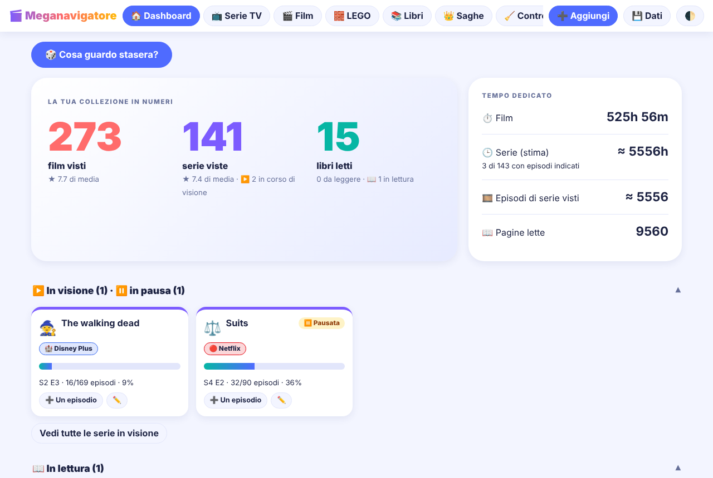
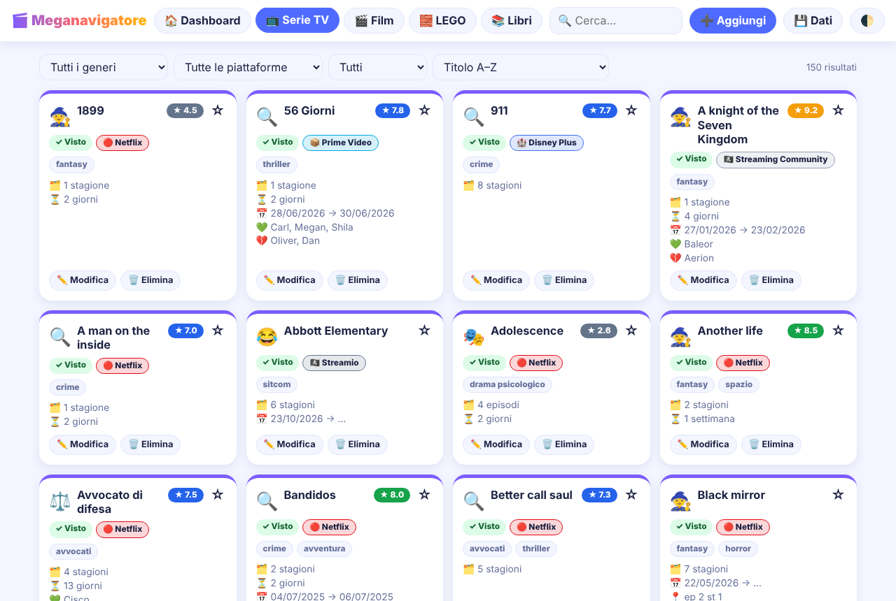
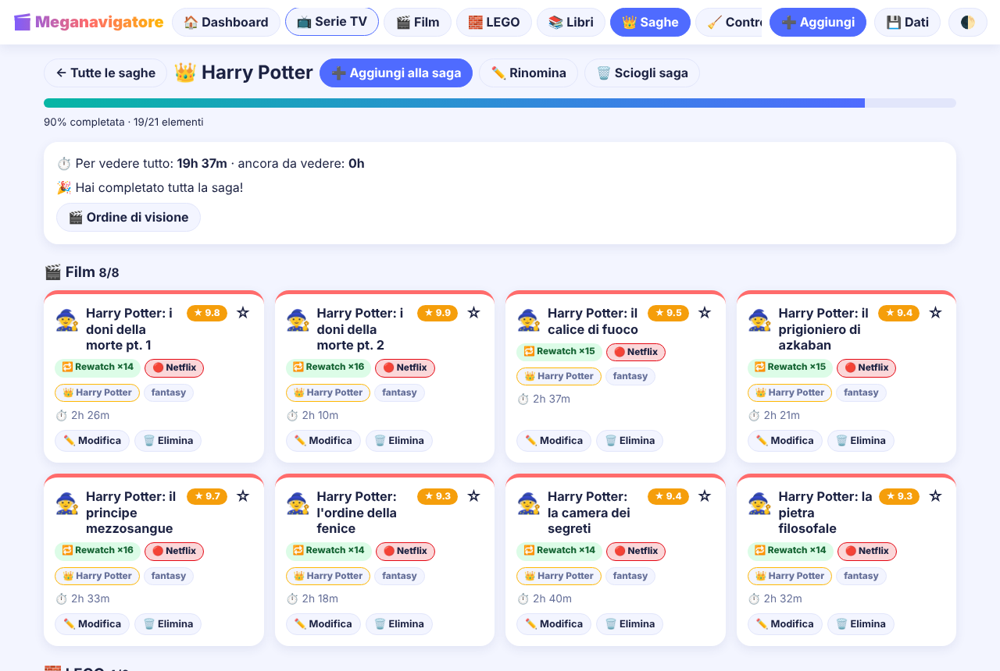
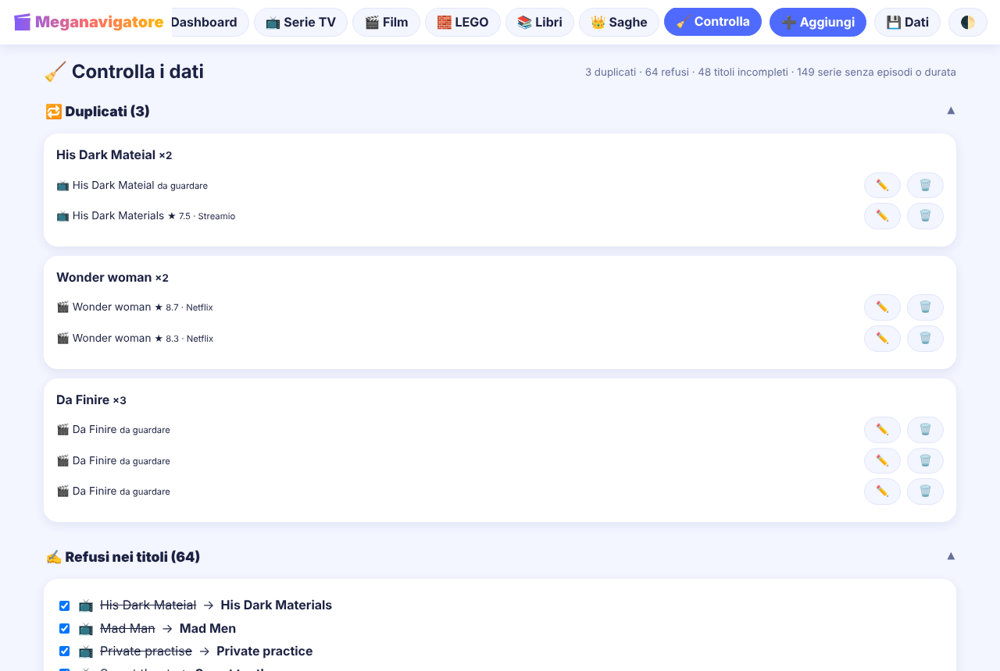
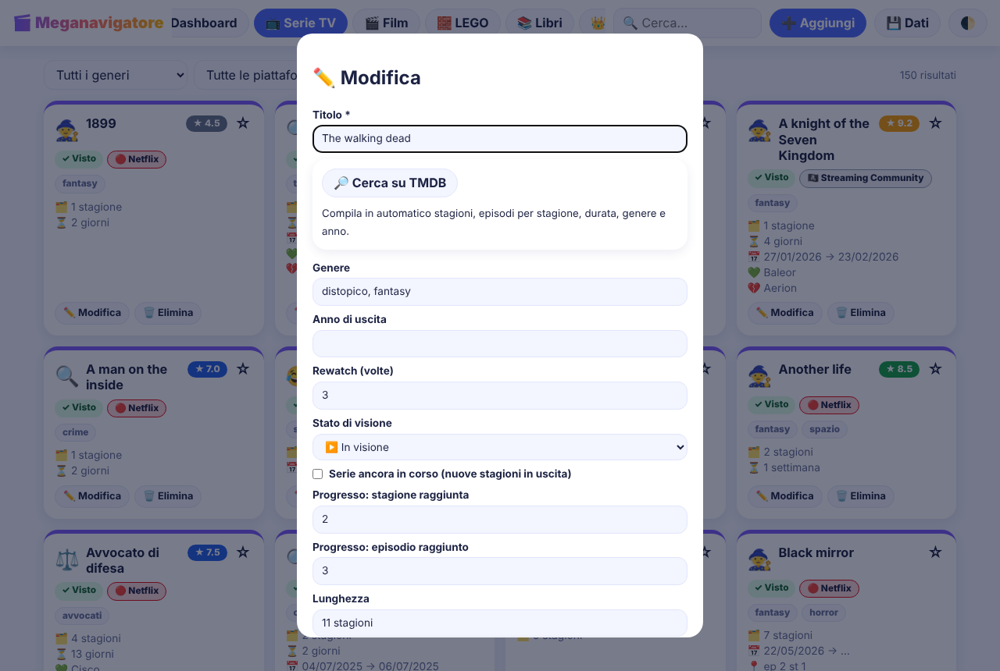

# 🎬 Meganavigatore

Un'applicazione web per tenere in ordine le proprie collezioni personali: **serie TV, film, set LEGO e libri**. Funziona nel browser, senza installare nulla e senza server: i dati restano sul tuo dispositivo.

Nata da un foglio Excel (`cinema.xlsx`), che è servito come punto di partenza per riempire il database iniziale.



## Cosa contiene

### 🏠 Dashboard
- Numeri principali: film visti, serie viste, libri letti, con la media dei voti.
- Tempo dedicato: ore di film, ore di serie TV, episodi visti e pagine lette.
- Sezioni **In visione** e **In lettura**, con barra di avanzamento e un pulsante per far avanzare di un episodio o di dieci pagine.
- Classifiche dei 5 titoli più votati e dei 5 più rivisti, grafici di generi, piattaforme e voti, riepilogo di LEGO (pezzi, costo medio a pezzo, ore di costruzione) e libri.
- Pulsante **🎲 Cosa guardo stasera?**: pesca a caso tra i titoli "da guardare", filtrando per tipo, piattaforma, genere e tempo disponibile.

### 📚 Le quattro collezioni


- **Serie TV**, **Film**, **LEGO** e **Libri**, con schede colorate, badge per voto e stato, copertine e immagini quando disponibili.
- Ricerca in tempo reale, filtri per genere, piattaforma, stato, saga e preferiti.
- Ordinamento alfabetico di base, oppure per voto, genere, durata o tempo di visione.
- Aggiunta, modifica ed eliminazione di ogni elemento, con preferiti ⭐ e note personali.

### 📺 Serie TV: stato, episodi e ore
- Stato di visione (In visione, Pausata, Completata) e indicazione "ancora in corso", con stagione ed episodio raggiunti.
- Episodi di ogni stagione e durata dell'episodio (di base 1 ora): le ore si calcolano da sole. Dove i dati mancano si usa una stima di 10 episodi a stagione, segnalata con "≈".

### 📖 Libri
- Stato di lettura (In lettura, In pausa, Finito) con pagina corrente: le pagine lette contano fino a dove sei arrivato.
- Autore, anno, pagine e copertina, compilabili da Open Library per un libro o per tutti insieme.

### 🧱 LEGO
- Codice del set, pezzi, prezzo e tempo di costruzione, con il costo a pezzo calcolato in automatico.
- Nome, pezzi, anno e immagine si compilano dal codice del set con Rebrickable, per un set o per tutti insieme (serve la chiave).

### 🔎 Compilazione automatica dei dati
- Nel modulo di una serie o di un film il pulsante **Cerca su TMDB** compila stagioni, episodi per stagione, durata, genere, anno e piattaforma.
- In **Controlla → Compila automaticamente** un solo avvio completa i dati mancanti di serie e film (TMDB), libri (Open Library) e LEGO (Rebrickable), a scelta per categoria. C'è una barra di avanzamento, il pulsante Ferma e pause per rispettare i limiti dei servizi. Vengono compilati solo i campi vuoti, e i casi dubbi finiscono in un elenco da verificare.

### 👑 Saghe e franchise
- Collega film, serie, libri e set LEGO dello stesso mondo, per esempio Harry Potter.
- Per ogni saga: avanzamento, voto medio, tempo totale, ordine di visione e "ti manca…".



### 📋 Progetti (Kanban)
- Bacheca con le colonne Da fare, In corso e Completato, partecipanti del team e attività assegnate.

### 🧹 Controlla i dati


- Trova duplicati, refusi nei titoli, dati mancanti e serie senza stagioni, episodi o durata.
- Offre la correzione dei refusi e una coda guidata per completare i dati.

### 💾 Dati, backup e tema
- Esporta in **JSON**, **SQL** o **Excel** e reimporta i backup (JSON o Excel).
- Ripristino dei dati originali, tema chiaro e scuro, uso da telefono.



## Come scaricarlo e usarlo

### Scaricarlo sul computer
1. Su GitHub premi il pulsante verde **Code** e scegli **Download ZIP**.
2. Estrai lo ZIP in una cartella.
3. Apri il file `public/index.html` con un doppio clic, usando Chrome, Edge o Firefox. Le cartelle e i file accanto a `index.html` devono restare dove sono.

Chi usa Git può clonare il repository:

```
git clone https://github.com/NOME-UTENTE/NOME-REPOSITORY.git
```

Alla prima apertura il database si riempie con i dati iniziali. Da quel momento ogni modifica viene salvata nel browser. Usa sempre lo stesso browser e, per sicurezza, fai un backup prima di spostare la cartella.

## Servizi esterni e chiavi

| Servizio | A cosa serve | Chiave |
|---|---|---|
| TMDB | dati di serie e film | gratuita, da richiedere su themoviedb.org |
| Rebrickable | nome e pezzi dei set LEGO | gratuita, da richiedere su rebrickable.com |
| Open Library | autore, anno, pagine e copertina dei libri | non serve |

Incolla le chiavi da **💾 Dati → 🔑 Chiave TMDB** e **🔑 Chiave Rebrickable**: restano solo nel browser e non entrano nei backup. Senza chiavi l'app funziona lo stesso: queste ricerche restano semplicemente spente.

## Cose da sapere

- **I dati sono nel browser.** Restano in quel browser e su quel dispositivo: se cambi computer, browser o cancelli i dati di navigazione, parti da zero. Usa **💾 Dati → Esporta** per fare i backup e **Importa** per ripristinarli.
- **Privacy.** I dati di partenza del file Excel sono nel file `public/js/seed.js`. Se carichi il progetto su un repository pubblico, chiunque può leggere quella lista: rendilo privato, oppure sostituisci il contenuto di `seed.js` con `const SEED={};`.
- **Internet serve** solo per TMDB, Rebrickable, Open Library, per le copertine e per l'esportazione e importazione Excel. Tutto il resto funziona anche senza rete.
- **Logo TMDB.** L'avviso richiesto da TMDB è in fondo alla pagina. Per mostrare anche il logo ufficiale, scaricalo dal sito di TMDB e salvalo come `public/tmdb-logo.svg`.

## Com'è fatto

Pagina HTML, un foglio di stile e JavaScript diviso in moduli, senza framework, senza server e senza passaggi di compilazione. Database nel browser con IndexedDB, in cinque tabelle: `serie_tv`, `film`, `lego`, `libri` e `progetti`.

```
public/index.html            la pagina
public/style.css             l'aspetto grafico
public/js/seed.js            i dati iniziali (la tua lista)
public/js/data.js            struttura delle collezioni e costanti
public/js/utils.js           funzioni di utilità
public/js/db.js              database nel browser
public/js/calc.js            calcoli: episodi, ore, pagine, saghe
public/js/screens.js         dashboard, schede ed elenchi
public/js/saghe.js           saghe e franchise
public/js/controlla.js       controllo dei dati
public/js/forms.js           moduli, preferiti, progetti, "stasera"
public/js/io.js              esportazione e importazione
public/js/tmdb.js            TMDB per un titolo
public/js/bulk.js            compilazione di massa da TMDB
public/js/libri.js           Open Library e stato di lettura
public/js/lego.js            Rebrickable
public/js/main.js            eventi e avvio
docs/                        screenshot
```

## Licenza

Distribuito con licenza **MIT**: vedi il file `LICENSE`. La licenza riguarda il codice. I dati delle liste personali e i contenuti dei servizi esterni appartengono ai rispettivi autori.

## Crediti

I dati di serie e film provengono da TMDB. This product uses the TMDB API but is not endorsed or certified by TMDB. I dati dei set LEGO provengono da Rebrickable e quelli dei libri da Open Library.
