# Base dei Nerd

Un'applicazione web per tenere in ordine le proprie collezioni personali: **serie TV, film, film d'animazione, set LEGO, libri e appunti**. Funziona nel browser, senza installare nulla e senza server: i dati restano sul tuo dispositivo.

Nata da un foglio Excel (`cinema.xlsx`), che è servito come punto di partenza per riempire il database iniziale.

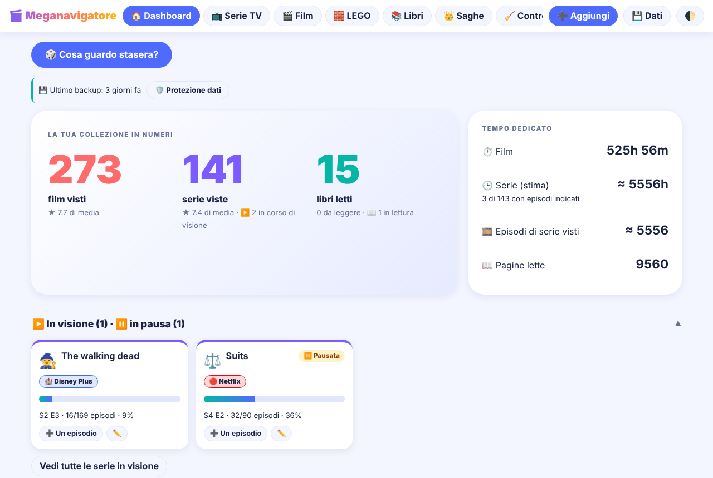

## Cosa contiene

### Dashboard
- Numeri principali: film visti, serie viste, libri letti, con la media dei voti.
- Tempo dedicato: ore di film, ore di serie TV, episodi visti e pagine lette.
- Sezioni **In visione** e **In lettura**, con barra di avanzamento e un pulsante per far avanzare di un episodio o di dieci pagine.
- Promemoria con la data dell'ultimo backup.
- **Prossime uscite**: il calendario delle puntate in arrivo delle serie in corso.
- **Da costruire**: la coda dei set LEGO che hai già, dal più piccolo, con il pulsante "Costruito".
- Classifiche dei 5 titoli più votati e dei 5 più rivisti, grafici di generi, piattaforme e voti, riepilogo di LEGO (pezzi, costo medio a pezzo, ore di costruzione) e libri.
- Pulsante **Cosa guardo stasera?**: pesca a caso tra i titoli "da guardare", filtrando per tipo, piattaforma, genere e tempo disponibile.

### Le collezioni
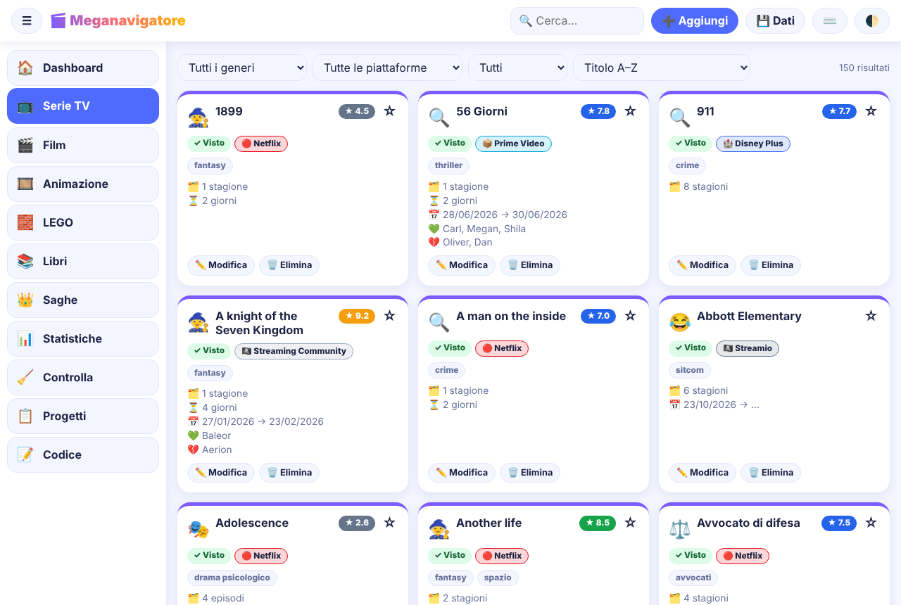

- **Serie TV**, **Film**, **Animazione**, **LEGO** e **Libri**, con schede colorate, badge per voto e stato, copertine e immagini quando disponibili.
- Ricerca in tempo reale, filtri per genere, piattaforma, stato, saga e preferiti.
- Ordinamento alfabetico di base, oppure per voto, genere, durata o tempo di visione.
- Aggiunta, modifica ed eliminazione di ogni elemento, con preferiti e note personali.

### Animazione
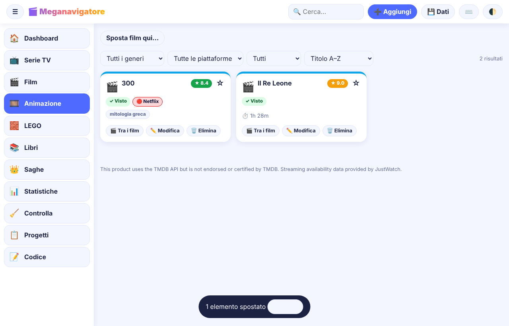

- Una sezione dedicata ai film d'animazione, con le stesse funzioni dei film: schede, filtri, stato di visione, voto, ricerca e compilazione da TMDB, ordinamento per i tuoi gusti, saghe e statistiche.
- I dati sono separati dai film, quindi le due liste non si mescolano. Nella dashboard hai il conteggio delle animazioni viste e le ore totali, a parte.
- Per portare qui i film che hai già: il pulsante "In Animazione" su ogni scheda, il pulsante "Sposta film qui" nella sezione Animazione e, in Controlla, l'elenco dei film con un genere di animazione.

### Serie TV: stato, episodi e ore
- Stato di visione (In visione, Pausata, Completata) e indicazione "ancora in corso", con stagione ed episodio raggiunti.
- Episodi di ogni stagione e durata dell'episodio (di base 1 ora): le ore si calcolano da sole. Dove i dati mancano si usa una stima di 10 episodi a stagione, segnalata con "≈".

### Libri
- Stato di lettura (In lettura, In pausa, Finito) con pagina corrente: le pagine lette contano fino a dove sei arrivato.
- Autore, anno, pagine e copertina, compilabili da Open Library per un libro o per tutti insieme.

### LEGO
- Codice del set, pezzi, prezzo e tempo di costruzione, con il costo a pezzo calcolato in automatico.
- Nome, pezzi, anno e immagine si compilano dal codice del set con Rebrickable, per un set o per tutti insieme (serve la chiave).
- Lista desideri con **priorità** (alta, media, bassa), **budget** totale con barra di avanzamento e suggerimento di cosa comprare in ordine di priorità, e i pulsanti **Comprato** e **Costruito**.

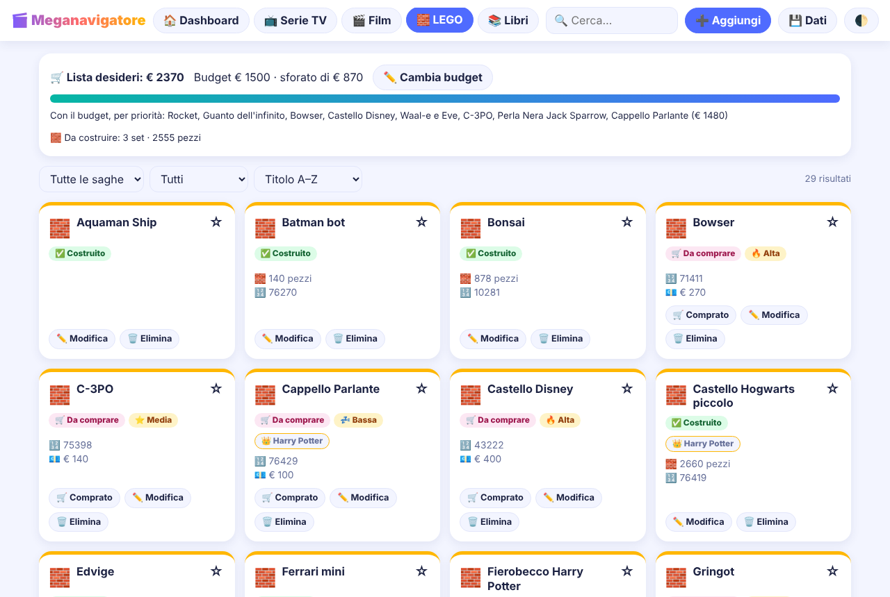

### Compilazione automatica dei dati
- Nel modulo di una serie o di un film il pulsante **Cerca su TMDB** compila stagioni, episodi per stagione, durata, genere, anno e piattaforma.
- In **Controlla → Compila automaticamente** un solo avvio completa i dati mancanti di serie e film (TMDB), libri (Open Library) e LEGO (Rebrickable), a scelta per categoria. C'è una barra di avanzamento, il pulsante Ferma e pause per rispettare i limiti dei servizi. Vengono compilati solo i campi vuoti, e i casi dubbi finiscono in un elenco da verificare.
- **Serie in corso**: un pulsante riscarica da TMDB gli episodi nuovi, la data della prossima puntata e dove guardarle, e segna come concluse quelle finite.
- **Dove guardarlo in Italia** (dati JustWatch via TMDB), **copertine** di film e serie e il pulsante **Simili**, che propone titoli simili da aggiungere a "da guardare".

### Saghe e franchise
- Collega film, serie, libri e set LEGO dello stesso mondo, per esempio Harry Potter.
- Per ogni saga: avanzamento, voto medio, tempo totale, ordine di visione e "ti manca…".

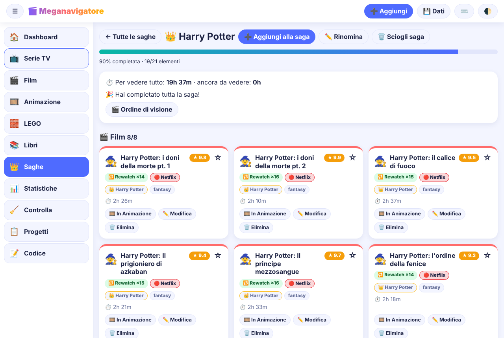

### Progetti (Kanban)
- Bacheca con le colonne Da fare, In corso e Completato, partecipanti del team e attività assegnate.

### Codice (appunti)
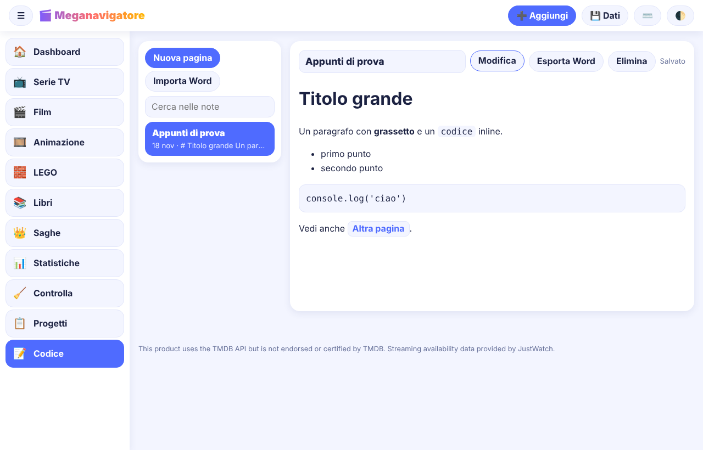

- Un ambiente per prendere appunti e snippet, ispirato a Obsidian: pagine da creare, modificare ed eliminare, con un elenco laterale e una ricerca.
- Editor con testo in stile Markdown (titoli con #, grassetto, codice, elenchi) e anteprima. Con [[Titolo]] colleghi le pagine tra loro e, in fondo a ogni pagina, vedi i collegamenti in entrata.
- Importa Word: carica un file .docx e crea una pagina modificabile. Esporta Word: scarica la pagina corrente come .docx. Le librerie (mammoth e docx) si caricano da internet solo quando servono.
- Le pagine restano nel database del browser e fanno parte dei backup e del salvataggio automatico su file.

### Statistiche
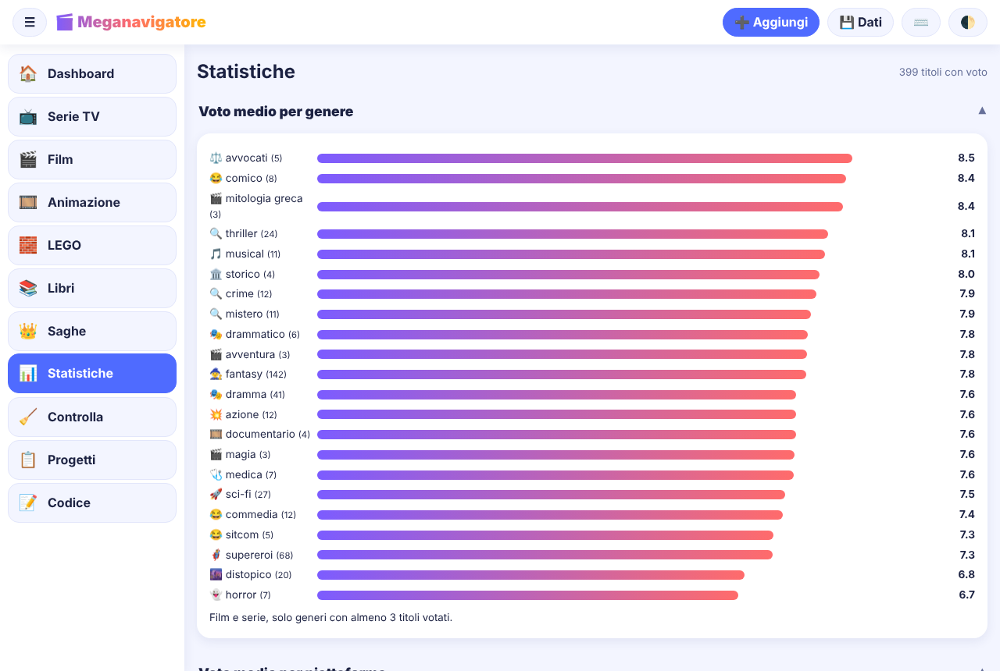

- Voto medio per genere e per piattaforma, le serie più lunghe e l'andamento nel tempo: titoli completati per anno e negli ultimi 12 mesi.
- Per i film l'andamento usa la data di visione, che puoi indicare nel modulo.

### Calendario delle uscite
- La dashboard mostra le prossime puntate delle serie in corso, e un pulsante le esporta in un file .ics da importare in Google Calendar o Outlook.

### Consigli dai tuoi gusti
- L'ordinamento "Per i tuoi gusti" di film e serie mette per primi i titoli da guardare con generi simili a quelli che hai votato di più, con un indicatore di affinità sulla scheda.

### Barra laterale
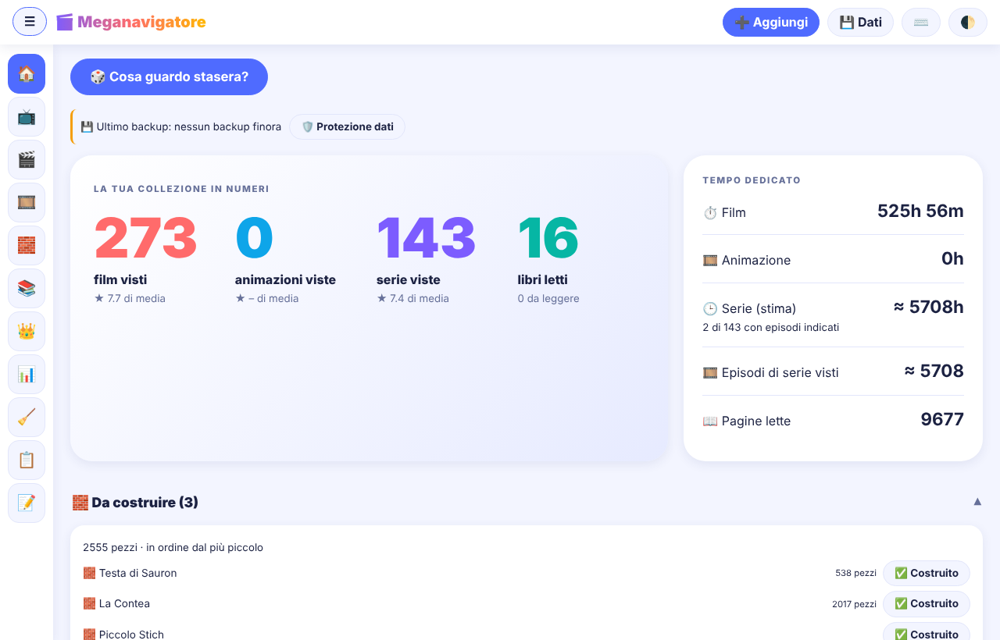

- La navigazione è in una barra laterale sinistra richiudibile: con il pulsante in alto a sinistra (o il tasto M) passa da icone ed etichette alle sole icone, e il contenuto si allarga con una transizione fluida. La scelta viene ricordata.
- Su telefono la barra è nascosta e si apre come un menu sopra la pagina.

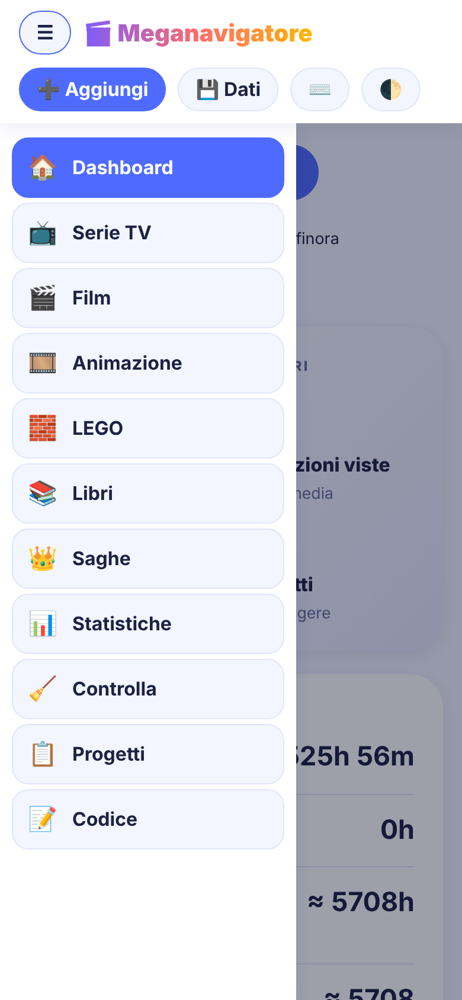

### Scorciatoie da tastiera
- / cerca, N aggiunge un elemento, S apre "Cosa guardo stasera?", T cambia tema, B apre la protezione dei dati, C apre Codice, M apre o chiude il menu laterale, i numeri da 1 a 9 e 0 cambiano scheda e Esc chiude le finestre.
- Il tasto ? o il pulsante con la tastiera, in alto, mostrano l'elenco completo.

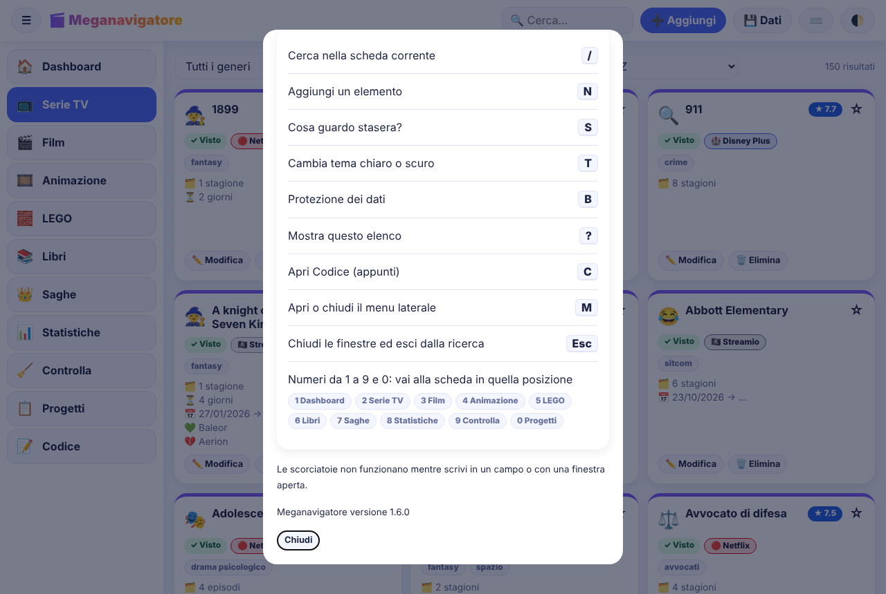

### Controlla i dati
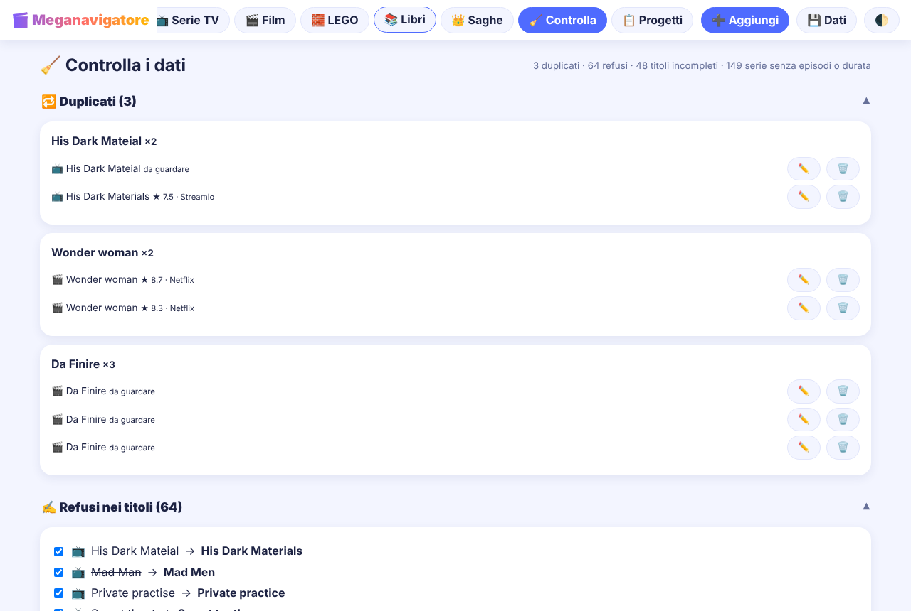

- Trova duplicati, refusi nei titoli, dati mancanti e serie senza stagioni, episodi o durata.
- Offre la correzione dei refusi e una coda guidata per completare i dati.

### Protezione dei dati
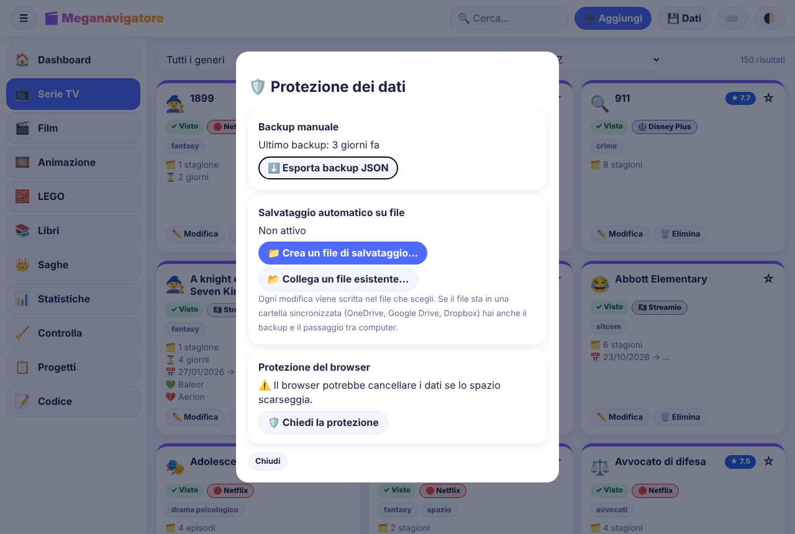

- **Salvataggio automatico su file** (Chrome o Edge): ogni modifica viene scritta in un file JSON che scegli tu. Se sta in una cartella sincronizzata (OneDrive, Google Drive, Dropbox) hai anche il backup e il passaggio tra computer. All'apertura, se il file è più recente dei dati del computer, l'app te lo segnala e ti chiede cosa fare.
- **Backup con versione** e migrazione automatica: i file creati con una versione più vecchia dell'app si importano senza problemi.
- **Anteprima prima di importare** ("Film: 278 → 12") e **Annulla** dopo ogni eliminazione.
- Promemoria dell'**ultimo backup** e richiesta al browser di non cancellare i dati da solo.

### Dati, backup e tema
- Esporta in **JSON**, **SQL** o **Excel** e reimporta i backup (JSON o Excel).
- Ripristino dei dati originali, tema chiaro e scuro, uso da telefono.

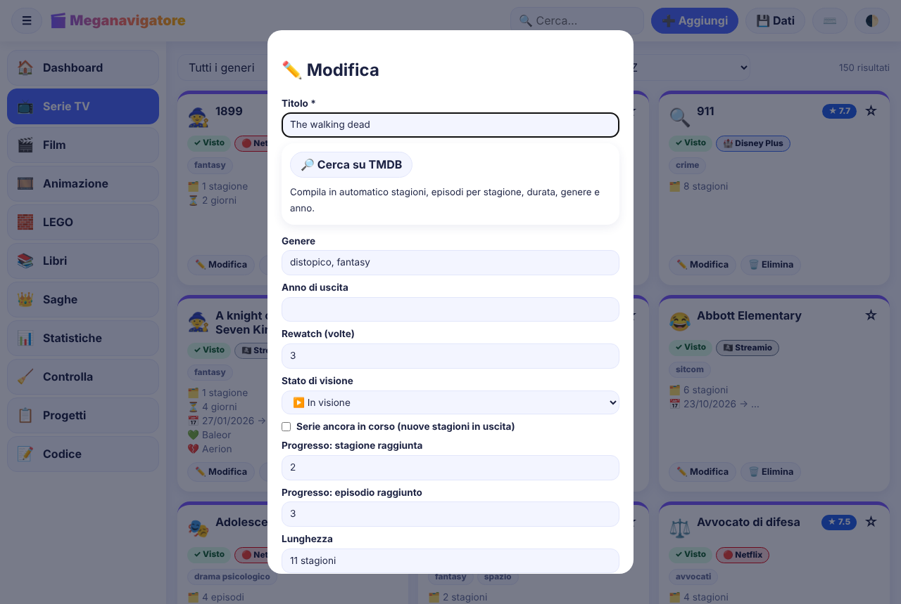

## Come scaricarlo e usarlo

### Scaricarlo sul computer
1. Su GitHub premi il pulsante verde **Code** e scegli **Download ZIP**.
2. Estrai lo ZIP in una cartella.
3. Apri il file `public/index.html` con un doppio clic, usando Chrome, Edge o Firefox. Le cartelle e i file accanto a `index.html` devono restare dove sono.

Chi usa Git può clonare il repository:

```
git clone https://github.com/NOME-UTENTE/NOME-REPOSITORY.git
```

Alla prima apertura il database si riempie con i dati iniziali. Da quel momento ogni modifica viene salvata nel browser. Usa sempre lo stesso browser e, per sicurezza, fai un backup prima di spostare la cartella.

## Servizi esterni e chiavi

| Servizio | A cosa serve | Chiave |
|---|---|---|
| TMDB | dati di serie e film | gratuita, da richiedere su themoviedb.org |
| Rebrickable | nome e pezzi dei set LEGO | gratuita, da richiedere su rebrickable.com |
| Open Library | autore, anno, pagine e copertina dei libri | non serve |

Incolla le chiavi da **Dati → Chiave TMDB** e **Chiave Rebrickable**: restano solo nel browser e non entrano nei backup. Senza chiavi l'app funziona lo stesso: queste ricerche restano semplicemente spente.

## Cose da sapere

- **I dati sono nel browser.** Restano in quel browser e su quel dispositivo: se cambi computer, browser o cancelli i dati di navigazione, parti da zero. Per proteggerli attiva il salvataggio automatico su file da **Dati → Protezione dati** (Chrome o Edge), oppure usa **Esporta** e **Importa**.
- **Privacy.** I dati di partenza del file Excel sono nel file `public/js/seed.js`. Se carichi il progetto su un repository pubblico, chiunque può leggere quella lista: rendilo privato, oppure sostituisci il contenuto di `seed.js` con `const SEED={};`.
- **Internet serve** solo per TMDB, Rebrickable, Open Library, per le copertine e per l'esportazione e importazione Excel. Tutto il resto funziona anche senza rete.
- **Logo TMDB.** L'avviso richiesto da TMDB è in fondo alla pagina. Per mostrare anche il logo ufficiale, scaricalo dal sito di TMDB e salvalo come `public/tmdb-logo.svg`.

## Com'è fatto

Pagina HTML, un foglio di stile e JavaScript diviso in moduli, senza framework, senza server e senza passaggi di compilazione. Database nel browser con IndexedDB, in sette tabelle: `serie_tv`, `film`, `animazione`, `lego`, `libri`, `progetti` e `note`.

```
public/index.html            la pagina
public/style.css             l'aspetto grafico
public/js/seed.js            i dati iniziali (la tua lista)
public/js/data.js            struttura delle collezioni e costanti
public/js/utils.js           funzioni di utilità
public/js/db.js              database nel browser
public/js/calc.js            calcoli: episodi, ore, pagine, saghe
public/js/screens.js         dashboard, schede ed elenchi
public/js/saghe.js           saghe e franchise
public/js/controlla.js       controllo dei dati
public/js/forms.js           moduli, preferiti, progetti, "stasera"
public/js/io.js              esportazione e importazione
public/js/protezione.js      backup, salvataggio automatico, protezione dati
public/js/gusti.js           affinità con i tuoi gusti
public/js/statistiche.js     pagina delle statistiche
public/js/calendario.js      esportazione delle uscite (.ics)
public/js/tastiera.js        scorciatoie da tastiera
public/js/codice.js          appunti, importazione ed esportazione Word
public/js/sidebar.js         barra laterale richiudibile
public/js/tmdb.js            TMDB per un titolo
public/js/bulk.js            compilazione di massa da TMDB
public/js/libri.js           Open Library e stato di lettura
public/js/lego.js            Rebrickable
public/js/main.js            eventi e avvio
CHANGELOG.md                 cronologia delle versioni
docs/                        screenshot
```

## Cronologia delle versioni

Il file `CHANGELOG.md` elenca le modifiche di ogni versione, dalla più recente.

## Licenza

Distribuito con licenza **MIT**: vedi il file `LICENSE`. La licenza riguarda il codice. I dati delle liste personali e i contenuti dei servizi esterni appartengono ai rispettivi autori.

## Crediti

I dati di serie e film provengono da TMDB. This product uses the TMDB API but is not endorsed or certified by TMDB. I dati dei set LEGO provengono da Rebrickable e quelli dei libri da Open Library. Streaming availability data provided by JustWatch.
